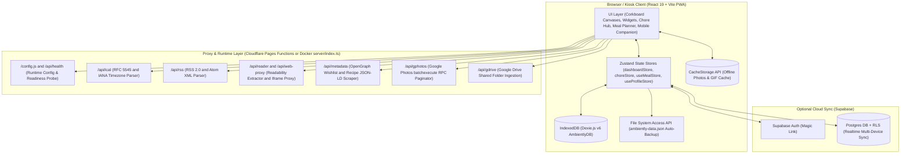

+++
title = "Architecture & Tech Stack"
weight = 40
+++

# Architecture & Technology Stack

Ambiently is engineered as a **Local-First Progressive Web App (PWA)** deployed on **Cloudflare Pages** (`dashboard.trinhism.com`) and packaged for parity self-hosting inside a **zero-dependency Node 22 multi-architecture Docker container** (`linux/amd64` + `linux/arm64`). Core boards boot instantaneously offline while sharing identical `/api/*` edge/server handlers and optional Supabase cloud sync.

---

## 1. System Architecture Diagram

---

## 2. Technology Stack Overview

| Layer | Technologies | Role & Implementation |
| :--- | :--- | :--- |
| **Frontend & Build** | [React 19](https://react.dev/), [Vite](https://vitejs.dev/), [TypeScript](https://www.typescriptlang.org/) | Declarative modular UI components, responsive canvases, and strict TypeScript typing. |
| **PWA & Offline Caching** | `vite-plugin-pwa` (Workbox) | Precached app shell alongside bounded runtime photo and media `CacheFirst` stores. |
| **Styling & Icons** | [Tailwind CSS v4](https://tailwindcss.com/), [Framer Motion](https://www.framer.com/motion/), [Lucide React](https://lucide.dev/) | Glassmorphic kiosk UI, smooth card animations, and customizable canvas/tab iconography. |
| **Local State & Storage** | [Dexie.js](https://dexie.org/) (`IndexedDB`) + [Zustand](https://github.com/pmndrs/zustand) | Client-first reactivity and durable structured IndexedDB tables (`AmbientlyDB` v6). |
| **Media & Document Parsing** | `libheif-js`, `@mozilla/readability`, `linkedom`, `ical.js`, `fast-xml-parser` | Client-side iOS `.HEIC`/`.HEIF` decoding, distraction-free article extraction, and RFC 5545 calendar recurrence parsing. |
| **Serverless & Docker Runtime** | Cloudflare Pages Functions + Node 22 ESM (`server/index.ts`) | Identical TypeScript handlers deployed on Cloudflare Edge or bundled into `dist-server/index.mjs` inside a ~55 MB non-root `node:22-alpine` image. |
| **Optional Cloud Sync** | [Supabase](https://supabase.com/) (Auth & Realtime Postgres) | Magic-link sign-in, multi-device WebSocket synchronization, and Row-Level Security (RLS) household sharing. |

---

## 3. Local-First Data Layer (`AmbientlyDB` v6)

`src/services/db.ts` manages 8 IndexedDB object stores via Dexie.js:

1.  **`settings`**: Global kiosk settings (`dockPosition`, `carouselEnabled`, `nightModeStyle`, `nightModeStart`, `nightModeEnd`, `wakeLockEnabled`, `pinHash`, `lockSettingsAccess`, `settingsPinOptOut`, `clockFormat`, `weekStartsOn`, `defaultWidgetStyle`, `photoAutoSyncInterval`, and pure-config shared photo source metadata).
2.  **`tabs`**: Ordered canvas definitions (`id`, `name`, `icon`, `order`, `autoRotateDurationSec`, `isHome`, `enabled`).
3.  **`widgets`**: Canvas tiles storing normalized viewport coordinates (`xRatio`, `yRatio`, `wRatio`, `hRatio`, `zIndex`, `rotation`, `isFullScreen`), isolated `mobileOrder`, and widget-specific configuration. Heavy runtime photo arrays and oversized inline `data:` image URLs are stripped before Cloud Sync pushes so synced snapshots stay `< 5 KB`.
4.  **`notes`**: Sticky notes, checklists, and aisle-grouped shopping lists (`isShoppingList: true`) scoped per board (or pinned globally), with soft-deletion (`archivedAt`) and expiration timestamps.
5.  **`localDeviceVault`**: Device-only storage for sensitive local tokens, Chromium `FileSystemFileHandle` persistence, and uploaded `ImageWidget` media (`vault://local-media:*`, included in `.json` backup exports) that never leaves your device for cloud sync.
6.  **`choreEngineState`**: Singleton household chore snapshot (`household_chores`) containing templates, active instances (`pending`, `awaiting_approval`, `completed`, `skipped`, `expired`), wishlist rewards, trophy case records, append-only ledger entries, deletion tombstones, and authoritative merge logic.
7.  **`householdProfiles`**: Shared family `Parent` and `Kid` profiles with avatars and colors.
8.  **`meals`**: Singleton household meal planner snapshot (`household_meals`) holding saved recipes, scheduled calendar meals (auto-pruned 21 days in the past), checked grocery keys, and cloud sync tombstones.

Workbox (`vite.config.ts`) maintains bounded runtime caches (`ambiently-photo-cache-v1` and `ambiently-media-cache-v1` capped at 120 entries / 14 days for static GIPHY/Wikimedia assets) while intentionally never caching tokenized Plex media URLs.

---

## 4. Proportional Canvas & 24/7 Kiosk Performance

To render crisply across 1080p tablets, 1440p desktop monitors, and 4K wall TVs:
*   **Native 1:1 Resolution**: The canvas renders natively (`w-full h-full`) without blurry CSS zoom scaling, positioning cards via normalized viewport ratios (`xRatio`, `yRatio`, `wRatio`, `hRatio`).
*   **Memoized Tile Isolation**: Canvas tiles wrap inside `MemoizedCanvasWidgetBody` (`React.memo` with ref-backed callbacks, scoped `willChange` promotion strictly during active drag/resize/rotate gestures, and React Portal bubble guards) so hovering or editing one widget never re-renders sibling tiles.
*   **Shared Clock Ticker & Power Suspension**: Time widgets subscribe to a single wall-clock-aligned ticker (`useSharedClock`), while `useDisplayActivity` automatically pauses animated `<video>` loops and photo rotation timers during `oled_clock` Night Mode or hidden browser tabs.

---

## 5. Unified `/api/*` Proxy Layer & SSRF Protections

Both Cloudflare Pages (`functions/api/`) and the self-hosted Node 22 server (`server/index.ts` via `vite.server.config.ts`) execute the same 7 TypeScript route handlers:

*   `/api/ical`: Normalizes `webcal://` to `https://`, parses `VEVENT` & `RRULE` blocks with `ical.js`, and caches responses for 15 minutes.
*   `/api/rss`: Normalizes RSS 2.0 and Atom XML feeds with 15-minute edge/server caching.
*   `/api/reader` & `/api/web-proxy`: Extracts clean article HTML via `@mozilla/readability` + `linkedom`, or proxies external sites blocked by `X-Frame-Options`.
*   `/api/metadata`: Extracts OpenGraph metadata, wishlist product pricing, and Schema.org `Recipe` JSON-LD blocks.
*   `/api/gphotos` & `/api/gdrive`: Resolves public Google Photos shared albums (`snAcKc` RPC pagination) and Google Drive folders (`?rescan=1` bypasses caches for scheduled/cooldown-protected manual rescans).
*   **SSRF Security (`functions/_shared/fetchExternal.ts`)**: Allows only public HTTPS URLs by default (inspecting every redirect, capping timeouts and response byte sizes, and rejecting cross-origin browser abuse). Docker hosts on private LANs may explicitly enable `AMBIENTLY_ALLOW_PRIVATE_FEEDS=true` for RFC1918 / `.local` calendars & RSS while keeping loopback (`127.0.0.1` / `localhost`) and cloud metadata (`169.254.169.254`) permanently blocked.
*   **Service-Worker-Safe Docker Config (`/config.js`)**: Because Workbox precaches `dist/index.html` by hash, `server/index.ts` dynamically serves runtime `SUPABASE_URL` / `SUPABASE_ANON_KEY` via `/config.js` (`Cache-Control: no-store`, excluded from Workbox precaching) rather than mutating HTML on boot.

---

## 6. License & Self-Hosting Attribution (AGPLv3)

Ambiently is open-source under the **GNU Affero General Public License v3.0 (AGPLv3)**. To prevent OLED burn-in and visual clutter, no permanent watermarks are drawn on the live wall canvas; instead, interactive attribution and source links live inside the **Ambiently Quick Hub popover** (top-left logo menu) and the **Settings & Changelog modal footers** (`Powered by Ambiently • trinhism.com • Source (AGPLv3)`).

Per **AGPLv3 Sections 7(b) and 13**, any self-hosted or modified network deployment must preserve those attribution notices and source links and make modified source code available under AGPLv3.
