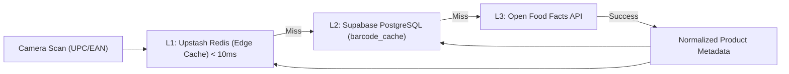

+++
title = "Features & Capabilities"
weight = 20
+++

# Features & Sensory Capabilities

CuratedLists provides an extensive suite of evaluation, collaboration, and community curation tools. This document provides a detailed breakdown of its core features.

---

## 🕸️ Sensory Spider Radar Geometry & Composite Scoring

Rather than relying on subjective one-dimensional star ratings, CuratedLists models taste across multiple custom dimensions:

*   **Multi-Axis Radar Polygons**: Dynamic SVG spider radar charts visually represent the flavor and sensory profile of each contender.
*   **Normalized Weighted Calculations**: Every attribute score is multiplied by its curator-assigned weight and normalized onto a universal 0–100 **Curated Benchmark Index (CBI)**.
*   **Calibrated S-D Tier Placement**:
    *   **S-Tier (Elite / Exceptional)**: $\ge 90.0$ CBI
    *   **A-Tier (Great / Recommended)**: $80.0 - 89.9$ CBI
    *   **B-Tier (Good / Solid)**: $70.0 - 79.9$ CBI
    *   **C-Tier (Average / Flawed)**: $60.0 - 69.9$ CBI
    *   **D-Tier (Poor / Avoid)**: $< 60.0$ CBI
*   **Manual Overrides**: Curators can toggle manual override mode to drag-and-drop cards between tiers to adjust for holistic intangibles.

---

## 🍷 Real-Time Collaborative Tasting Rooms & Blind Reveals

CuratedLists features a synchronized multi-user tasting room engine designed for dinner parties, club tastings, and sensory flights:

1. **Collision-Resistant Room Codes**: Hosts generate a 6-character room code (e.g., `/tasting/AB79XY`) or display an on-screen QR code for mobile participants to scan at `/tasting/join`.
2. **Blind Tasting Mode**:
   * Conceals real product titles (`Sample #1`, `Sample #2`, `Sample A`).
   * Conceals bottle packaging and label artwork behind a frosted mystery veil to eliminate brand perception bias.
3. **Multi-Judge Radar Polygons**:
   * As judges submit ratings on their own phones, the master room display overlays each individual judge's sensory polygon in translucent accent colors.
   * A thick, high-contrast white polygon renders the **Group Consensus Average**.
4. **Flight Standings Leaderboard**: Once the host initiates the reveal, the app unmasks all contender identities, calculates the Group Consensus CBI, and awards flight podium honors.

---

## 🌟 Crowdsourced Community Commons (`/community/[slug]`)

Every major curation theme can have a shared public commons alongside personal rosters:

*   **Decoupled Architecture**: Personal rosters (`/@username/[slug]`) reflect individual palates; Community Commons (`/community/[slug]`) represent crowdsourced consensus.
*   **1-Tap Chevron Upvotes & Social Reactions**: Community members can react with **Likes** (wine tint) and **Promotes** (amber flame), or upvote individual contenders.
*   **Dynamic Consensus Tier Board**: Automatically projects crowd ratings and upvotes into a living S–D Tier Board without requiring manual administrative gates.
*   **Personal Tier Sandbox**: Visitors can interactively reorganize contenders in their own client-side sandbox, compare their rankings against the crowd with delta markers, and click **"Save as My Roster"** to fork the list directly to their profile.
*   **Taste Alignment Engine**: Calculates a *"My Taste vs The Community"* percentage match and highlights the most controversial items where the curator strongly disagrees with the consensus.
*   **1200×630 Graphic Tier Cards**: Client-side HTML5 Canvas export creates ready-to-share social banner cards highlighting the top S-tier champions.

---

## 📷 Universal Barcode Scanner & 3-Tier Edge Cache

The barcode scanning pipeline is engineered for sub-second lookups:

*   **Automated Normalization**: Extracts structured brand names, product titles, volume/size attributes, and product artwork.
*   **Mobile-First Modal**: Uses dynamic viewport calculations (`100dvh` and visual viewport listeners) to ensure scanner controls, torch toggles, and manual input fallbacks never get cut off by mobile browser chrome.

---

## 🌐 SSRF-Guarded OpenGraph Scraper

*   **Security First**: Dedicated edge endpoint (`/api/metadata/parse-url`) with IP validation that rejects private IPv4 subnets (RFC 1918), localhost loopbacks, and AWS/cloud metadata services (`169.254.169.254`).
*   **Domain Archetypes**: Custom parsers for Steam, Google Maps, Apple Maps, YouTube, and Spotify.
*   **Edge Cache**: Metadata is stored in Upstash Redis for 24 hours keyed by URL SHA-256 hash.
